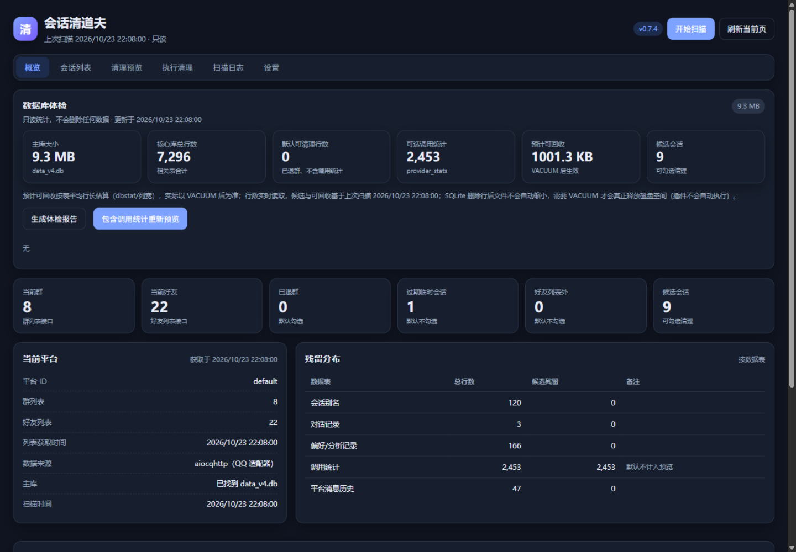
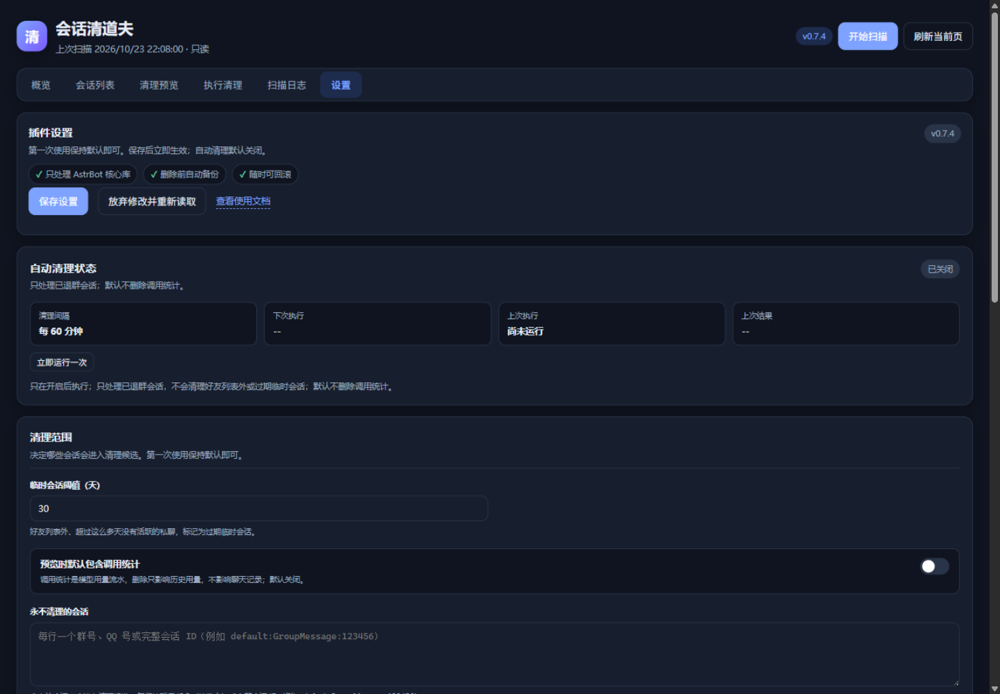

# 会话清道夫


AstrBot 核心库会保留已退群、好友列表外（疑似已删好友）、过期临时会话的数据。会话清道夫先把这些数据扫描出来，让你看清会删什么、先备份，再执行；删错了可以回滚。

> **第一次使用建议只扫描和预览，不执行删除。** 确认候选无误后，再点「执行清理」。

## 为什么需要它

- 群退了、好友列表外了，核心库里可能还留着会话别名、偏好记录和调用统计。
- 直接改数据库风险高；本插件先预览、再备份、删除后可回滚。
- 自动清理默认关闭，只处理已退群会话，不会悄悄删除好友或临时会话。

## 功能

- **先体检、再清理**：扫描核心库里的残留会话，先看清理预览；删除前自动生成整库快照 + 逐行备份。
- **删错能回滚**：每次清理都能回滚；回滚前再备份，遇到同主键新数据默认不覆盖。
- **自动清理默认关闭**：开启后只处理已退群会话，执行后写日志、发通知；不会自动清理好友列表外或过期临时会话。
- **还有**：会话详情、扫描日志、与上次扫描对比、清理明细导出、备份体积显示。

## 效果预览





> 截图使用示例数据，不包含真实群名、QQ 号或聊天内容。

## 安装

### 环境要求

| 项目 | 要求 |
|---|---|
| AstrBot | `>=4.29.0,<5` |
| Python | 3.12+（跟随 AstrBot 要求） |
| 消息平台 | **aiocqhttp（QQ OneBot / NapCat）** |
| 额外依赖 | 无，安装后即可使用 |

### 插件市场（推荐）

在 AstrBot WebUI 的插件市场搜索「会话清道夫」或 `astrbot_plugin_session_janitor`，安装后重载插件。如果暂时搜不到，请使用下面的手动安装方式。

### 手动安装

1. 把整个 `astrbot_plugin_session_janitor` 目录放到：

   ```text
   AstrBot/data/plugins/astrbot_plugin_session_janitor/
   ```

2. 在 Dashboard 的插件页重载插件（或重启 AstrBot）。
3. 打开：

   ```text
   Dashboard → 插件 → 会话清道夫
   ```

## 快速开始

1. **开始扫描**：打开面板，点右上角「开始扫描」。插件会读取当前群/好友列表并扫描核心库。
2. **看清理预览**：切到「清理预览」，确认会处理哪些会话、哪些表、多少行。默认 0 行通常是正常的，说明候选只剩调用统计。
3. **执行清理**：确认无误后切到「执行清理」，勾选要清理的会话，输入「确认删除」。执行前会自动备份。
4. **需要时回滚**：在「执行清理 → 备份与回滚」里找到对应备份，点「回滚」，输入「确认回滚」。

> 第一次使用不要急着开自动清理。先手动扫描一次，确认候选和预览符合预期。

## 使用说明

### 扫描与分类

插件把核心库里的会话分成五类：

| 状态 | 含义 | 默认勾选 |
|---|---|---|
| 已退群 | 群已不在当前群列表里 | 是 |
| 好友列表外（疑似已删好友） | 私聊对象不在当前好友列表里 | 否 |
| 过期临时会话 | 好友列表外，且超过阈值天数没有活跃 | 否 |
| 活跃 | 当前仍在群/好友列表里 | 否 |
| 白名单 | 命中白名单，永不清理 | 否 |

插件无法区分“删了好友”和“换了号”，统一按“好友列表外”处理；其中超过阈值天数没有活跃的私聊，再标记为“过期临时会话”。两类都默认不勾选，需要手动确认。

### 清理预览

预览是只读的，不会删除数据。它会按数据表列出“将处理多少行”，例如：

- 会话别名（`umo_aliases`）
- 对话记录（`conversations`）
- 偏好/分析记录（`preferences`）
- 调用统计（`provider_stats`，默认不计入）
- 平台消息历史（`platform_message_history`）

调用统计（`provider_stats`）是 AstrBot 每次调用模型时记下的用量流水（哪个会话、哪个模型、多少 token、耗时多久）。删除它只会丢失历史用量统计，不影响聊天记录、偏好设置或机器人运行，所以默认不清理。

### 执行清理与回滚

- 执行清理需要输入中文四个字：**确认删除**。
- 删除前会生成整库快照 + 逐行 JSON 备份；快照失败会中止清理。
- 删除在单事务内完成，失败自动回滚。
- 回滚需要输入中文四个字：**确认回滚**。
- 回滚前会自动备份当前数据库；同一份备份回滚过一次后不能再次回滚。
- 如果回滚会覆盖同主键的新数据，插件会先询问选择「跳过冲突」还是「强制覆盖」；默认不会静默覆盖。

### 定时自动清理

在「设置」页开启「定时自动清理」，并设置清理间隔（默认 60 分钟）。开启后：

- 每隔设定时间扫描一次当前群/好友列表和核心库；
- **只清理「已退群」且仍有核心数据的会话**；
- 好友列表外、过期临时会话不会被自动清理；
- 默认不删调用统计，可在设置里单独打开；
- 删除前照常生成整库快照 + 逐行备份；
- 执行结果写入「扫描日志」，并按通知配置发送摘要。

自动清理默认关闭。设置页会显示当前状态、下次执行时间、上次执行结果，也可以点「立即运行一次」马上执行一次（会二次确认并先备份）。

### 设置页

设置页按使用场景分组，常用项默认展开；平台实例和读取超时收在「高级设置」里，保留备份份数放在「备份与磁盘」并显示当前占用。

| 设置 | 默认 | 说明 |
|---|---|---|
| 临时会话阈值（天） | 30 | 好友列表外、超过这么多天没活跃的私聊，标记为过期临时会话 |
| 预览时默认包含调用统计 | 关闭 | 打开后清理预览默认计入调用统计（`provider_stats`） |
| 永不清理的会话 | 空 | 每行一个群号、QQ 号或完整会话 ID（例如 `default:GroupMessage:123456`） |
| 开启定时自动清理 | 关闭 | 开启后按间隔自动扫描并清理已退群会话 |
| 自动清理间隔（分钟） | 60 | 开启后按该间隔执行；关闭自动清理请用上面的开关 |
| 自动清理也删除调用统计 | 关闭 | 打开后自动清理会连调用统计一起删 |
| 发送通知 | 开启 | 自动清理执行后发送摘要；手动清理不会发通知 |
| 通知发送到 | 空 | 每行一个群号或 QQ 号；留空发给 AstrBot 管理员 |
| QQ 平台实例 | `default` | 多个 QQ 机器人时才需要改 |
| 读取群/好友列表超时（秒） | 10 | 网络慢时可调大；超时会停止扫描 |
| 保留备份份数 | 5 | 超过份数会删除最旧的备份；面板会显示当前备份份数和总占用 |

保存后立即生效。页面底部有「有未保存的修改」提示和保存栏，可以「保存并离开」；不会因为忘了点保存而丢配置。

## 常见问题

### 为什么候选有 9 个，清理预览却是 0 行？

候选里可能大部分**只剩调用统计**。该项默认不清理，所以预览默认不计入这些行；面板会把这类条目默认隐藏并标注“仅剩调用统计”。如果你确认要连用量统计一起清掉，勾选「包含调用统计」或「显示仅剩调用统计的条目」即可。

### 为什么清理后候选列表里还有条目？

同上，大概率只剩调用统计。这是预期行为，不是清理失败。

### 为什么清理后数据库文件没有变小？

SQLite 删除行后不会自动缩小文件。要真正释放磁盘空间，需要在空闲时段手动执行 `VACUUM`；本插件不会自动 VACUUM。体检里的“预计可回收空间”是按表平均行长做的粗略估算，实际以 VACUUM 后为准。

### 为什么详情页看不到对话记录？

AstrBot 核心库的 `conversations` 表只保存**真正和机器人进行过 LLM 对话**的会话，数量通常很少。QQ 群/好友的普通聊天正文不在核心框架里，所以这里只能显示核心库实际保存的内容。

### 候选行数是聊天消息条数吗？

不是。它是这个会话在核心库里匹配到的**数据库行数**（会话别名、偏好、调用统计等），用来判断清理规模，不等于聊天消息数量。

### 自动清理没有执行？

检查：

- 「开启定时自动清理」是否打开；
- 「自动清理间隔」是否在 1–1440 分钟之间（关闭自动清理请用上面的开关）；
- 是否有「已退群」且仍有核心数据的会话；
- 最近是否出现群/好友列表骤降（插件会跳过自动清理并写日志）；
- 「扫描日志」里的最近一次自动清理结果。

### 回滚时提示冲突怎么办？

说明备份里的行和当前数据库里的同主键数据不一致。选择「跳过冲突」不会覆盖当前数据；选择「强制覆盖」会用备份行替换当前行。不确定时先选跳过，再手动核对。

### 为什么有些偏好记录提示“跨会话共享”？

同一行偏好可能被多个群/会话引用。整行删除会误伤其他会话，所以这类记录默认跳过，不会自动清理；详情里会标注“跨会话共享，不会自动清理”。

### 支持 WebChat、Telegram、飞书等平台吗？

不支持。插件依赖 QQ OneBot 的群/好友列表，只允许 `aiocqhttp` 平台；设置页会把不支持的平台禁用。其他平台即使能打开面板，也无法正确扫描群/好友列表。

### 数据会上传吗？

不会。插件没有遥测，不上传任何数据；备份、日志和运行状态都保存在你自己的 AstrBot 数据目录。

## 安全边界

- **只操作 AstrBot 核心库 `data_v4.db`**：扫描、体检、预览全程只读，仅执行清理时使用写连接；清理前生成整库快照 + 逐行 JSON 备份。
- 群/好友列表获取失败、超时或返回异常结构时立即停止扫描，不产生候选。
- 清理在单事务内完成，失败自动回滚。
- 白名单会话永不清理；跨会话共享的偏好行默认跳过。
- 删除量 ≥500 行时在提交前执行 `PRAGMA quick_check`；失败自动回滚并标记备份失败。
- 回滚前按主键检测冲突，默认不覆盖；安全快照失败会中止回滚。
- `platform_sessions` 表当前不处理，面板会标注“已跳过”。

## 注意事项

1. 回滚会覆盖同主键的新数据，除非在冲突提示里选择「跳过冲突」；默认不会静默覆盖。
2. “预计可回收空间”是按表平均行长做的粗略估算，实际以 VACUUM 后为准。
3. 插件不自动执行 VACUUM；需要真正缩小数据库文件时请自行在空闲时段执行。

## 数据与备份位置

| 内容 | 位置 |
|---|---|
| 主库 | `AstrBot/data/data_v4.db` |
| 插件配置 | `AstrBot/data/config/astrbot_plugin_session_janitor_config.json` |
| 插件数据 | `AstrBot/data/plugin_data/astrbot_plugin_session_janitor/` |
| 备份目录 | `AstrBot/data/plugin_data/astrbot_plugin_session_janitor/backups/` |

> 备份包含完整 `data_v4.db` 快照（含私密聊天和人设数据），请限制备份目录权限，不要提交到公开仓库。

## 兼容性

- **AstrBot**：`>=4.29.0,<5`
- **平台**：`aiocqhttp`（QQ OneBot / NapCat）
- **不承诺支持**：QQ 官方接口、WebChat、Telegram、Discord、飞书等；这些平台没有群/好友列表或历史消息接口。
- **不处理**：`platform_sessions`、其他插件的数据、QQ 官方接口。

## 开发与测试

```bash
python -m py_compile main.py page_api.py core/*.py
python -m unittest discover -s tests -v
node --check views/dashboard/app.js
```

当前测试 74 项；GitHub Actions 在 push 和 pull request 时运行同一套检查。

回滚只恢复五张核心表并校验列名；相关回归测试在 `tests/test_regressions.py`。

## 更新日志

见 [CHANGELOG.md](CHANGELOG.md)。

## License

[MIT](LICENSE) © 2026 SX0YYYY
